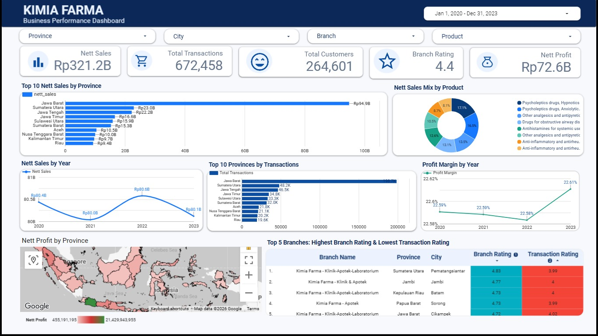

# Kimia Farma Performance Analytics (2020–2023)

Big Data Analytics project completed as part of the Kimia Farma x Rakamin Academy Project-Based Internship.

## Quick Access

[Interactive Dashboard](https://datastudio.google.com/reporting/f9a0e337-f6df-469b-82f4-f61c9f039cbe) · [Presentation PDF](./Kimia-Farma-Performance-Analytics-Presentation.pdf) · [SQL Query](./tabel_analisa.sql)

## Project Overview

This project evaluates Kimia Farma's business performance from 2020 to 2023 using transaction, product, branch, and inventory data.

The workflow covers data preparation in Google BigQuery, SQL transformation into a single analytical table, and interactive visualization in Google Looker Studio.

## Business Questions

- How did Nett Sales perform from 2020 to 2023?
- Which provinces contributed the most sales and transactions?
- How consistent was profitability across the period?
- Which branches had strong Branch Ratings but relatively lower Transaction Ratings?
- How were sales and profit distributed across products and regions?

## Data Sources

| Dataset | Main Information |
|---|---|
| `kf_final_transaction` | Transaction, customer, date, price, discount, transaction rating |
| `kf_product` | Product name, category, price |
| `kf_kantor_cabang` | Branch name, city, province, branch rating |
| `kf_inventory` | Inventory by branch and product |

> Note: `kf_inventory` was imported as part of the source data, but it is not used in the main analytical table because the required dashboard fields are derived from transaction, product, and branch data.

## Workflow

`CSV source data` → `BigQuery` → `tabel_analisa` → `Looker Studio` → `Business insights`

### BigQuery Transformation

The analytical table combines transaction, branch, and product information and adds:

- `persentase_gross_laba`
- `nett_sales`
- `nett_profit`
- `rating_cabang`
- `rating_transaksi`

The full transformation query is available in [`tabel_analisa.sql`](./tabel_analisa.sql).

## Dashboard Highlights

| Metric | Result |
|---|---:|
| Nett Sales | Rp321.2B |
| Total Transactions | 672,458 |
| Total Customers | 264,601 |
| Nett Profit | Rp72.6B |
| Average Profit Margin | ~22.6% |

The dashboard includes:

- Top 10 Nett Sales by Province
- Nett Sales Mix by Product
- Nett Sales by Year
- Top 10 Provinces by Transactions
- Profit Margin by Year
- Nett Profit by Province
- Top 5 Branches: Highest Branch Rating & Lowest Transaction Rating
- Interactive filters for date, province, city, branch, and product

## Key Insights

- West Java contributes around **29.5%** of total Nett Sales.
- The top 5 provinces contribute around **53.7%** of total Nett Sales.
- Annual Nett Sales remained relatively stable at around **Rp80B per year**.
- Profit Margin remained close to **22.6%** across the period.
- Top-rated branches still show lower Transaction Ratings, indicating a gap between overall branch perception and transaction experience.

## Dashboard Preview



## Repository Files

```text
.
├── dashboard-preview.png
├── Kimia-Farma-Performance-Analytics-Presentation.pdf
├── README.md
└── tabel_analisa.sql
```

## Tools

**Google BigQuery** · **SQL** · **Google Looker Studio** · **GitHub**

## Author

**Muhammad Alfaruqi Ramzan Mahrudin**  
Mathematics Graduate, Universitas Pendidikan Indonesia  
Data Analyst Support Intern, PT Cemerlang Statistika Indonesia (StatsMe)

[LinkedIn](https://www.linkedin.com/in/alfaruqiramzan/) · [GitHub](https://github.com/Alfaruqi-Ramzan)
